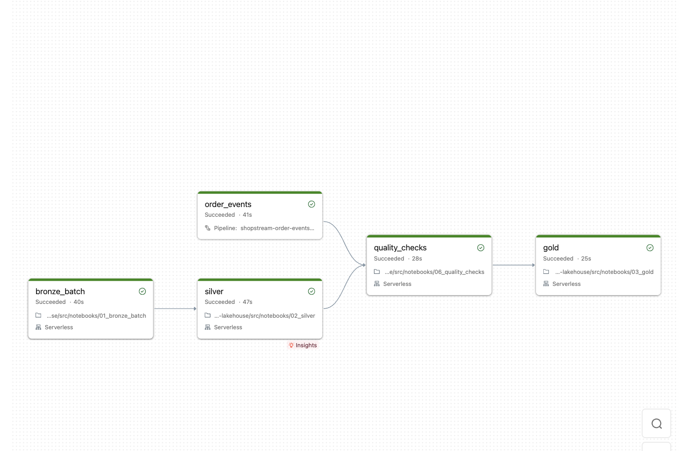
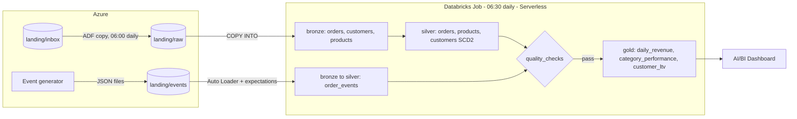
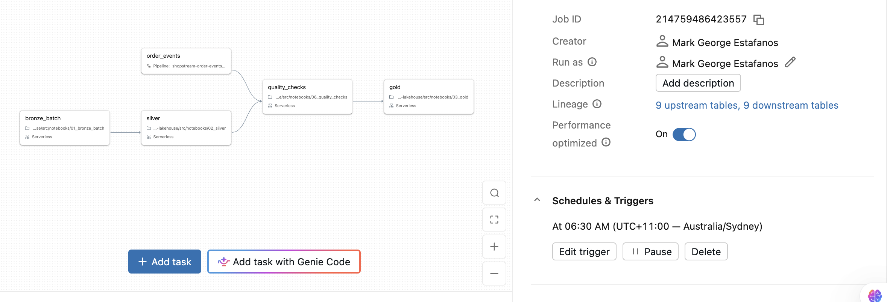
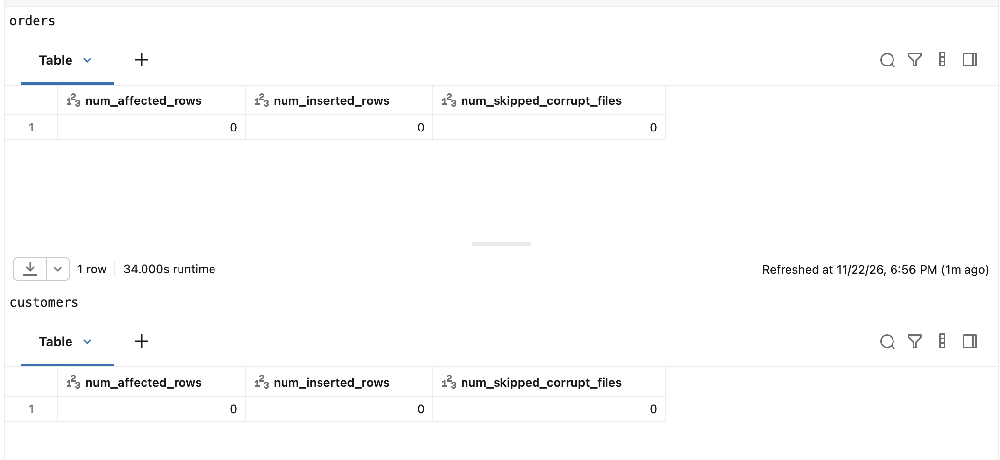
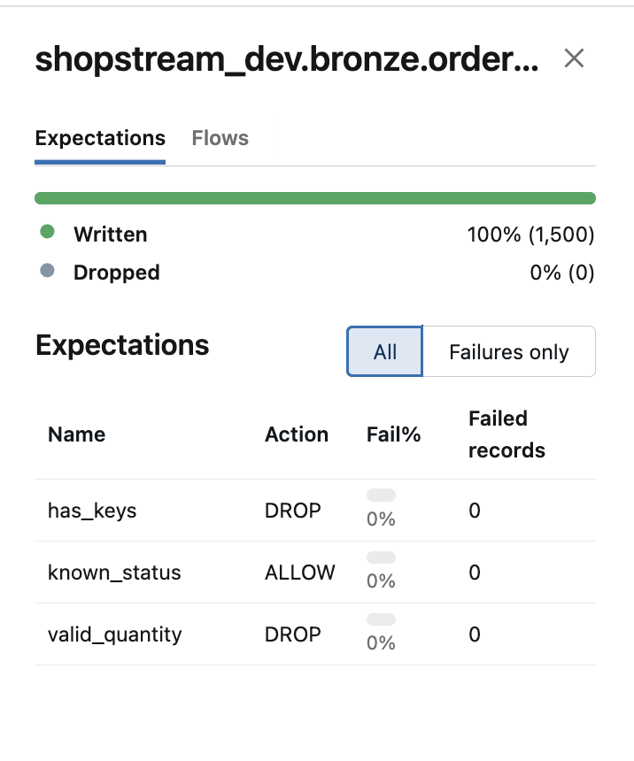
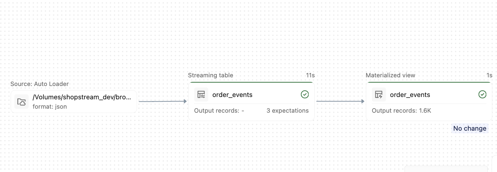
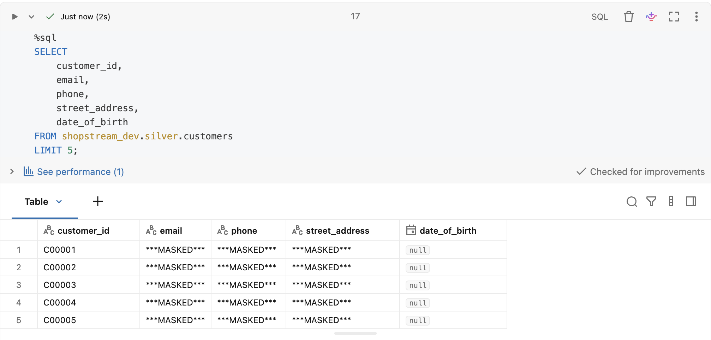
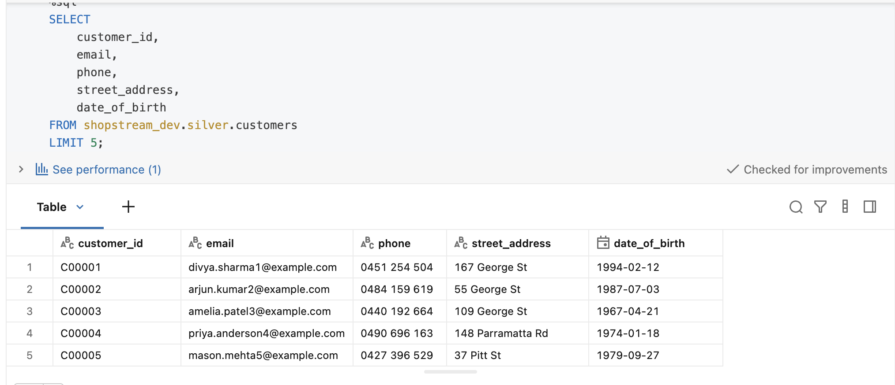
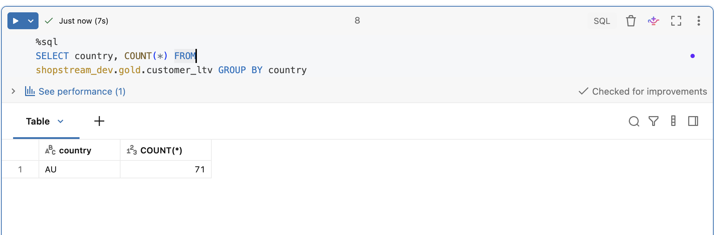
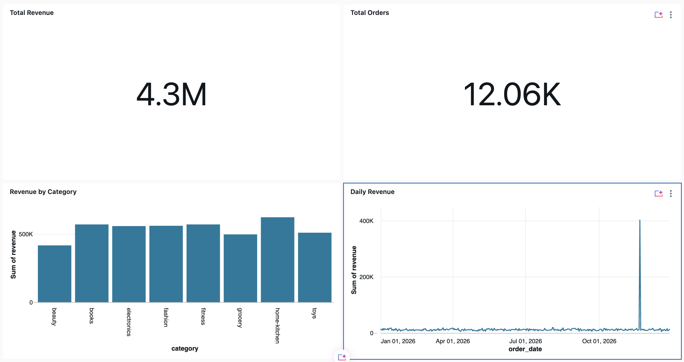

# ShopStream: Azure Databricks Lakehouse (Batch + Streaming)

An end-to-end e-commerce data platform on **Azure Databricks with Unity Catalog**. Daily batch files and a live order-event stream are loaded into a **bronze → silver → gold** lakehouse, checked by a quality gate, governed with column masks and row filters, and served to a dashboard. One scheduled Databricks Job runs the whole thing every morning.



---

## Architecture



### Job DAG



| Task | Type | Depends on | What it does |
|---|---|---|---|
| `bronze_batch` | Notebook | – | `COPY INTO` raw CSVs into bronze (idempotent) |
| `silver` | Notebook | bronze_batch | Clean, dedupe, SCD Type 2 customers, PII masks |
| `order_events` | Lakeflow pipeline | – | Auto Loader streaming table with expectations → deduplicated silver view |
| `quality_checks` | Notebook | silver, order_events | 6 checks on silver; the job **stops here** if any fail |
| `gold` | Notebook | quality_checks | Business tables, row filter, analyst grants, sanity check |

The batch and streaming branches run in parallel and meet at the quality gate. The whole job takes about 2–3 minutes.

---

## Tech stack

| Area | Tools |
|---|---|
| Cloud | Azure (ADLS Gen2, Azure Data Factory, Access Connector), region Australia East |
| Compute | Databricks serverless (notebooks, Lakeflow, SQL warehouse) |
| Storage format | Delta Lake |
| Governance | Unity Catalog: catalogs, external locations, volumes, grants, column masks, row filters, lineage |
| Batch ingest | `COPY INTO` |
| Streaming ingest | Auto Loader (`read_files` / `cloudFiles`) in a Lakeflow Declarative Pipeline |
| Orchestration | ADF daily trigger + Databricks Jobs (DAG, job parameters, cron schedule) |
| Serving | AI/BI Dashboard on a serverless SQL warehouse |
| Languages | PySpark, Spark SQL |

---

## Key design decisions

**1. Medallion layers with strict direction.** Gold only reads silver, never bronze. Bronze keeps raw data exactly as it arrived (plus `_source_file` and `_ingested_at`), so silver can always be rebuilt.

**2. Idempotent batch loads.** `COPY INTO` tracks which files it has already loaded, so re-running the job doesn't duplicate data. A re-run loads 0 rows:



**3. Quality gate *before* gold (audit-before-publish).** `06_quality_checks` runs between silver and gold. It collects every failed check and then raises, so bad data never reaches the dashboard. A failed check is deterministic, so the task has no retries.

**4. Expectations on the stream.** The streaming table enforces three rules: `valid_quantity` and `has_keys` drop the row; `known_status` warns but keeps it. Results are recorded per pipeline update.

| Pipeline | Expectations (1,500 events, 0 dropped) |
|---|---|
|  |  |

**5. One source of truth for gold.** Batch and streaming orders are unioned once into an `all_orders` view, and all three gold tables read from it. This guarantees the dashboard numbers agree across tables.

**6. Pipeline owns the streaming tables.** The Lakeflow pipeline creates and owns `bronze.order_events` and `silver.order_events`, with its own checkpoints. Notebooks only read them.

**7. Governance in Unity Catalog, not in the app.**
- **Column masks** on `email`, `phone`, `street_address` and `date_of_birth`. Only members of `pii_readers` see real values.
- **Row filter** on `gold.customer_ltv`. Analysts only see Australian customers.
- **Grants** give the `analysts` group read access to gold only.

| Masked (default) | Unmasked (`pii_readers`) | Row filter |
|---|---|---|
|  |  |  |

**8. Environment-agnostic code.** Every notebook and the pipeline read a `catalog` parameter (`shopstream_dev` / `shopstream_prod`), passed down from the job. Nothing in the job path hard-codes an environment. Ad-hoc queries live separately in `99_exploration`.

**9. Schedule after ingest.** ADF lands files at 06:00 and the job runs at 06:30 (Australia/Sydney). A file-arrival trigger on `bronze/raw` was considered. It would be more robust if ADF ran late, but a fixed schedule is simpler to operate and reason about.

---

## Results



- **$4.30M revenue across 12,056 completed orders**, consistent across all three gold tables
- **Pre-aggregated gold tables cut rows scanned per dashboard query by over 98%** (22,119 → 8 / 336 rows)
- **Category query latency down 37%** (581 → 364 ms); full dashboard refresh down 21% (948 → 745 ms)
- **1,600 streamed events ingested exactly once**, with 0 rows dropped by expectations
- **SCD Type 2** history on customers (1,000 current rows + 20 historical versions)

At this data size, every query carries about 200–350 ms of fixed overhead, so the scan reduction matters more than the latency numbers. Full details are in [docs/results.md](docs/results.md).

---

## Repository layout

```
src/
  notebooks/
    00_setup               # catalogs, schemas, volumes (one-off)
    01_bronze_batch        # COPY INTO
    02_silver              # cleaning, SCD2, masks
    03_gold                # gold tables, row filter, grants
    04_stream_events.py    # event generator (writes JSON files)
    05_stream_autoloader   # learning notebook: Auto Loader outside a pipeline
    06_quality_checks      # quality gate
    99_exploration         # ad-hoc queries, not part of the job
  pipelines/order_events.sql   # Lakeflow pipeline: streaming table + silver view
  dashboards/                  # AI/BI dashboard definition
  generate/                    # seed data generators
infra/adf/                     # ADF ARM templates (pipeline + daily trigger)
data/sample/                   # sample CSVs
docs/                          # setup, results, data quality, screenshots
```

---

## How to run

1. **Azure:** create a resource group, an ADLS Gen2 account (`landing` + `lake` containers), a Premium Databricks workspace and an Access Connector with *Storage Blob Data Contributor* on the storage account. See [docs/setup.md](docs/setup.md).
2. **Unity Catalog:** create a storage credential, external locations and the `shopstream_dev` catalog. Run `00_setup` for the schemas and volumes.
3. **Data:** upload `data/sample/*.csv` to `landing/inbox` (ADF copies them to `raw`), or straight to `/Volumes/shopstream_dev/bronze/raw/`.
4. **Pipeline:** create a Lakeflow pipeline from `src/pipelines/order_events.sql` (serverless, triggered) with the configuration `catalog = shopstream_dev`.
5. **Job:** create the 5-task job shown above with the job parameter `catalog = shopstream_dev`, then **Run now**.
6. **Streaming (optional):** run `04_stream_events.py` to generate live events, then re-run the job.
7. **Dashboard:** import `src/dashboards/ShopStream_Sales.lvdash.json`.

---

## Known limitations

- **SCD2 change detection uses `<>`**, which misses changes to or from NULL, and `country` isn't tracked. A fix would be `IS DISTINCT FROM` plus a hash of the tracked columns.
- **`silver.orders` is a full rebuild** each run (`CREATE OR REPLACE`). It's fine at 22k rows; at scale it should be an incremental `MERGE`.
- **Synthetic spike on 21 Nov 2026:** all 1,600 streamed events have that day's timestamp, so daily revenue shows one large spike ($390k).
- **Generated live `order_id`s can collide** with batch IDs, so the order count is off by one (12,055 vs 12,056); revenue is unaffected.
- **Dev only.** The `shopstream_prod` catalog exists, but there is no automated deployment yet.

## Next steps

- Databricks Asset Bundle to define the job and pipeline as code and deploy to prod
- GitHub Actions CI: lint and unit tests on every push
- Terraform for the Azure + Unity Catalog setup
- File-arrival trigger, plus job failure notifications
