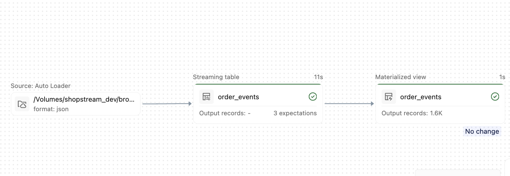

# Data quality

Quality is checked in two places: on the stream as it arrives, and on silver before gold is built.

## 1. Expectations on the stream (Lakeflow pipeline)

Defined in `src/pipelines/order_events.sql` on the streaming table `bronze.order_events`.

| Expectation | Rule | On failure |
|---|---|---|
| `valid_quantity` | `quantity > 0` | Drop the row |
| `has_keys` | `order_id`, `customer_id`, `product_id` not null | Drop the row |
| `known_status` | `status IN ('completed', 'cancelled')` | Keep the row, record the failure |

Missing keys or a bad quantity make a row useless, so it's dropped. An unknown status could just be a new status the business added, so it's kept and counted rather than thrown away.

Result for the main streaming load: 1,500 rows written, 0 dropped.

Duplicates are removed in the next step, the `silver.order_events` view, which keeps one row per `event_id`.

## 2. Quality gate on silver (`06_quality_checks`)

Runs in the job after `silver` and `order_events`, and before `gold`.

| Check | Catches |
|---|---|
| No duplicate order lines | Dedupe in silver not working |
| No quantities ≤ 0 | Bad rows reaching silver |
| Statuses are lower case | Inconsistent values breaking `status = 'completed'` filters |
| No cancelled orders in silver | The cancelled-order delete not running |
| One current row per customer | SCD2 merge going wrong |
| No duplicate live events | Stream dedupe not working |

Each check is a query that should return 0. The notebook runs all six, prints PASS/FAIL for each, then raises an error if any failed. That fails the task, so `gold` doesn't run and the dashboard keeps yesterday's data instead of showing bad numbers.

The task has no retries, because a failed check fails again on the same data.

## 3. Sanity check on gold

At the end of `03_gold`, each gold table is counted and the notebook fails if any is empty. This catches a gold build that ran but produced nothing.
