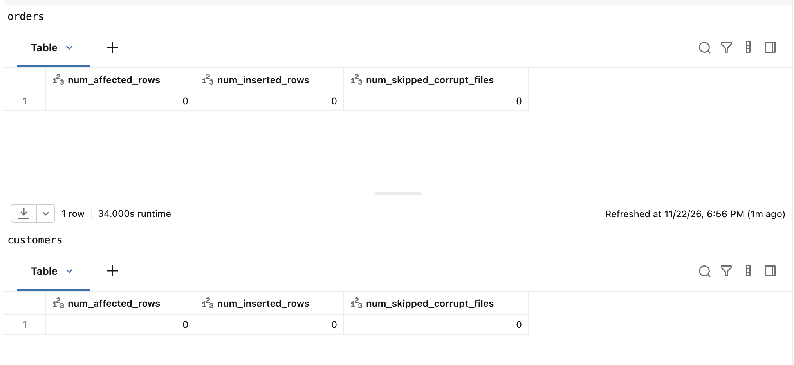

# Results

## Data

| Table | Rows |
|---|---|
| silver.orders (batch order lines) | 22,119 |
| silver.order_events (streamed, deduplicated) | 1,600 |
| silver.customers | 1,020 (1,000 current + 20 historical versions) |
| gold.daily_revenue | 336 days |
| gold.category_performance | 8 categories |

Completed revenue is **$4,303,018** in all three gold tables.

## Benchmark: dashboard queries, silver vs gold

**Question:** does pre-aggregating into gold tables make the dashboard faster?

**Method**
- Ran the same two dashboard queries against silver (aggregating on the fly) and against gold (pre-aggregated).
- Serverless SQL warehouse, warm, so the first run wasn't counted.
- Timings and rows read are taken from Query History.

| Query | Silver | Gold | Change |
|---|---|---|---|
| Revenue by category: time | 581 ms | 364 ms | 37% faster |
| Daily revenue: time | 367 ms | 381 ms | no real change (noise) |
| Full dashboard refresh | 948 ms | 745 ms | 21% faster |
| Rows read per query | 22,119 | 8 / 336 | over 98% fewer |

**What it shows**

I expected around 50% faster. The category query got 37% faster and the daily query didn't change.

The reason is that at 22k rows the actual work is tiny. Each query spends roughly 200–350 ms on fixed overhead (planning, scheduling, returning results), whatever the table size. Gold can't remove that overhead, so the time saved is capped.

The rows-read number is the one that scales. Gold reads 8 or 336 rows instead of 22,119. With millions of orders the silver queries would grow with the data, while the gold queries would stay about the same.

## Streaming

- 64 JSON files, 1,600 events, loaded once by Auto Loader (re-runs read 0 new files)
- Expectations: 1,500 events in the main load, 0 dropped
- All live events are stamped 21 Nov 2026, so that day shows a spike of about $390k (1,430 completed live orders)

## Idempotency

Running the batch load again inserts 0 rows into orders, customers and products, because `COPY INTO` skips files it has already loaded.

